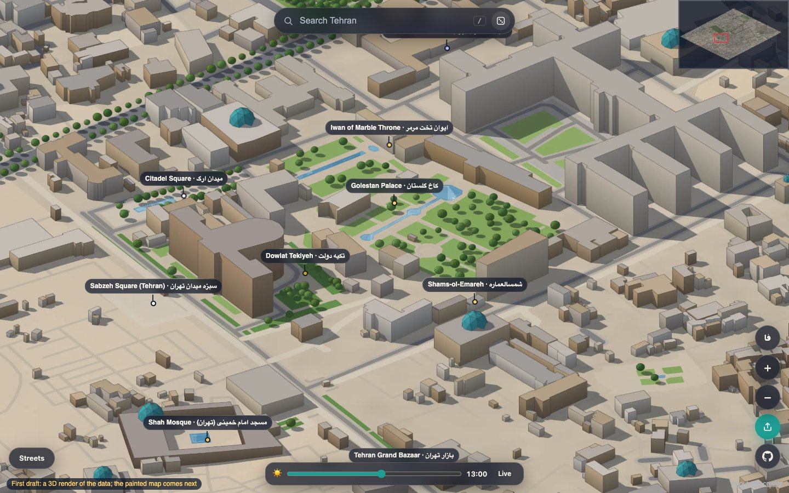
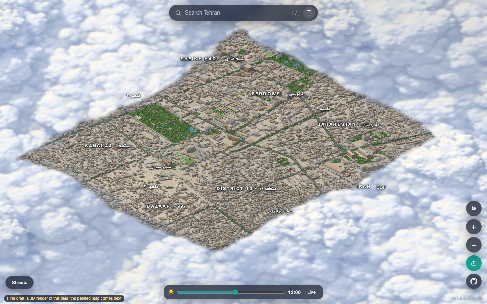
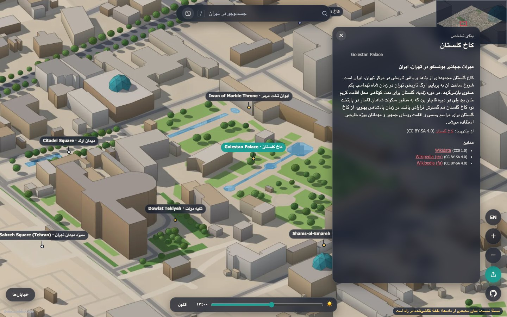
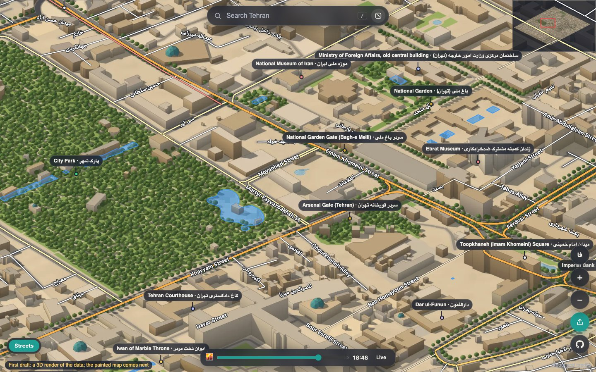

# Isometric Tehran · تهران ایزومتریک

Tehran's historic core as an explorable isometric map, seen from the south-east: the Grand Bazaar, Golestan Palace,
Toopkhaneh (Imam Khomeini) Square, the old government quarter round the National Garden, and Lalehzar Street.
In English and Persian.

See it at **[amirdaraee.github.io/isometric-tehran](https://amirdaraee.github.io/isometric-tehran/)**.

**Status: first draft: 3D render, painting next.** The map is an untextured 3D render made straight from open
data: buildings extruded to their heights on the real terrain, with streets, parks, water, trees and sun shadows.
The next step paints it as an inked illustration, in the style of
[Isometric Luxembourg](https://github.com/amirdaraee/isometric-luxembourg) (see [ROADMAP.md](ROADMAP.md)).

| The whole map | Persian interface, landmark card |
|---|---|
|  |  |

| Golden hour, Streets layer |
|---|
|  |

## What's in it

- **The historic core** (bbox 35.668–35.700 N, 51.405–51.440 E, about 3.2 × 3.6 km), rendered at 0.25 m per
  pixel: 11,954 buildings, 11,415 trees, terrain, streets, parks and pools.
- **Two languages.** Place labels on the map are in the interface language; the tooltip, the picked place and its
  card show both names ("Golestan Palace · کاخ گلستان"). Far out only the main landmarks and districts are named;
  more places come in as you zoom, smaller ones as dots first, and a label never covers a more important one. The
  interface switches between English and Persian (right to left) with the فا / EN button, or `?lang=fa`. Search matches English and Persian
  names, including Arabic letter forms and names typed without the zero-width joiner.
- **Landmarks:** 32 pins with cards, from Wikidata and Wikipedia, each with its sources.
- **Time of day:** a slider and a "Live" button on Tehran's clock. Until night and golden hour are painted, they are
  a colour grade over the day map.
- **Streets layer** with street names, **search**, **share** (every view has its own link), and a sea of clouds
  round the edge.

## Run it locally

    cd web
    npm install
    npm run dev          # http://localhost:3000
    npm test             # unit tests (Node 22.18 or newer)
    npm run build        # the site in web/dist

The first-draft tiles are small (about 11 MB) and are committed in `web/public/tiles/`, so the map works straight
after cloning. To rebuild them from the data, see [How the map is made](#how-the-map-is-made).

## How to help

Contributions are welcome: translations, landmarks, data fixes, viewer features and the painting.
[CONTRIBUTING.md](CONTRIBUTING.md) explains the setup, the checks, how to add a landmark or a translation, and
lists good first issues. Every change goes through a pull request with a review. Please read the
[Code of Conduct](CODE_OF_CONDUCT.md); report security problems as described in [SECURITY.md](SECURITY.md).

**Paint a block.** The map is painted block by block with an open model and the inked style of Isometric
Luxembourg, and anyone with a 24 GB GPU, or a few dollars of GPU time on their own RunPod account, can paint one.
Try `python paint/paint.py dry-run` (no GPU needed), then see [docs/PAINTING.md](docs/PAINTING.md) and open a
[Paint a block](https://github.com/amirdaraee/isometric-tehran/issues/new?template=paint-block.yml) issue.

The easiest way to improve the map is to improve OpenStreetMap: building heights (`height`, `building:levels`)
and English and Persian names (`name:en`, `name:fa`) in central Tehran flow straight into the next render.

## How the map is made

The city is configured in [`city.json`](city.json): bounding box, metric projection (UTM 39N), camera, resolution
and time zone. The pipeline is in `pipeline/` (Python 3.11+):

    cd pipeline
    uv venv && uv pip install -r pyproject.toml --extra fetch --extra dev
    .venv/bin/python fetch_data.py all     # OSM, Overture, Copernicus DEM, Wikidata/Wikipedia -> data/raw/ (about 6 MB)
    .venv/bin/python build_scene.py        # terrain, ground image, buildings, trees -> data/work/scene.npz
    .venv/bin/python render.py             # isometric frames (OpenGL, about 10 s) -> data/work/frames/
    .venv/bin/python build_tiles.py        # deep-zoom pyramid -> web/public/tiles/
    .venv/bin/python build_places.py       # pins, landmark cards, street lines -> web/public/data/
    .venv/bin/python build_water_mask.py   # water effect mask
    .venv/bin/python build_clouds.py mask  # where the clouds start

1. **Terrain:** the Copernicus GLO-30 surface model, smoothed into bare ground.
2. **Buildings:** Overture footprints (OpenStreetMap plus Microsoft ML Buildings), with OSM tags joined in.
   Heights come from OSM `height` or `building:levels`, then Overture, then a default by building type and size
   (`pipeline/heights.py`). Mosques get a turquoise dome.
3. **Ground:** an image of land use, parks, water, squares and roads by class, draped on the terrain.
4. **Render:** a 2:1 dimetric orthographic camera from the south-east (the same view as Isometric Luxembourg),
   a low sun from the west-south-west with shadow mapping, contact shadows at wall feet and thin ink lines where
   surfaces meet. A second pass records what is where (ground, road, water, wall, roof, tree) for the water effect
   and, later, as a guide for the painter.

5. **Paint:** the render is painted block by block (4800 px blocks, overlapping by 1200 px, outward from Golestan
   Palace) with Qwen-Image-Edit-2511 and the inked style LoRA, each block holding its finished neighbours so they
   meet without seams. See [docs/PAINTING.md](docs/PAINTING.md).

[docs/DATA.md](docs/DATA.md) lists every source with its date and licence.

## Publishing

`main` is published to GitHub Pages by [`.github/workflows/pages.yml`](.github/workflows/pages.yml), built with
the base path `/isometric-tehran/` for https://amirdaraee.github.io/isometric-tehran/. Every public file is loaded
through `asset()` in `web/src/config.ts`, so the site works under that sub-path.

To move to a custom domain later: set `VITE_BASE: /` and `CNAME: your.domain` in the workflow's build step (the
build writes `dist/CNAME`), set the domain in the repository's Pages settings, point DNS at GitHub Pages, and
update `siteUrl` in `city.json` and `og:url` in `web/index.html`.

When the painted tiles grow past what belongs in git (the repo check allows 150 MB of tiles), they move to
release assets or object storage: build with `TILES_URL=https://…` and the viewer loads tiles from there.

## Data and credits

| Layer | Source | Licence |
|---|---|---|
| Streets, parks, water, places, building tags | © [OpenStreetMap](https://www.openstreetmap.org/copyright) contributors, via the Overpass API | ODbL 1.0 |
| Building footprints and heights | [Overture Maps Foundation](https://overturemaps.org), buildings theme (OSM and Microsoft ML Buildings) | ODbL 1.0 |
| Terrain | [Copernicus DEM GLO-30](https://registry.opendata.aws/copernicus-dem/), © DLR e.V. 2010-2014 and © Airbus Defence and Space GmbH 2014-2018, provided under COPERNICUS by the European Union and ESA | Copernicus DEM licence (free use with attribution) |
| Landmark names, coordinates, descriptions | [Wikidata](https://www.wikidata.org) | CC0 1.0 |
| Landmark summaries | [Wikipedia](https://www.wikipedia.org) (English and Persian), linked on each card | CC BY-SA 4.0 |

## Acknowledgements

- **[Isometric Luxembourg](https://github.com/amirdaraee/isometric-luxembourg):** this project is its sister. The
  viewer, the feature switches, the clouds and water effects, the camera and the tile pipeline come from there.
- **[isometric.nyc](https://isometric.nyc)** by Andy Coenen
  ([isometric-nyc](https://github.com/cannoneyed/isometric-nyc), MIT, see `web/LICENSE.isometric-nyc`): the
  viewer started as a fork of it, and its idea of a whole city as one isometric illustration started all this.
- **[Pixel Singapore](https://www.yadongxie.com/blog/how-pixel-singapore-was-made)** by Yadong Xie: the painting
  method the next step will follow, and many ideas for the living layers.
- **[OpenStreetMap](https://www.openstreetmap.org/copyright) contributors**, read through the
  [Overpass API](https://overpass-api.de).
- **[Overture Maps Foundation](https://overturemaps.org)** and Microsoft's ML building footprints.
- **[Copernicus](https://dataspace.copernicus.eu)** (DLR, Airbus, the European Union and ESA) for the elevation
  model, served on the [AWS Open Data Registry](https://registry.opendata.aws/copernicus-dem/).
- **Wikidata and Wikipedia** editors, in English and Persian.
- **Viewer:** [OpenSeadragon](https://openseadragon.github.io), [React](https://react.dev) and
  [Vite](https://vite.dev). **Render:** [ModernGL](https://github.com/moderngl/moderngl),
  [Shapely](https://shapely.readthedocs.io), [pyvips](https://github.com/libvips/pyvips).

## Licence

Code: [MIT](LICENSE). Art (the rendered and, later, painted map and any drawings): [CC BY-NC 4.0](LICENSE-ART.md).
Data keeps its own licences, listed above. Painting uses Qwen-Image-Edit-2511 (Apache-2.0) and the project's style
LoRAs (CC BY-NC 4.0); see [docs/PAINTING.md](docs/PAINTING.md#licences).
